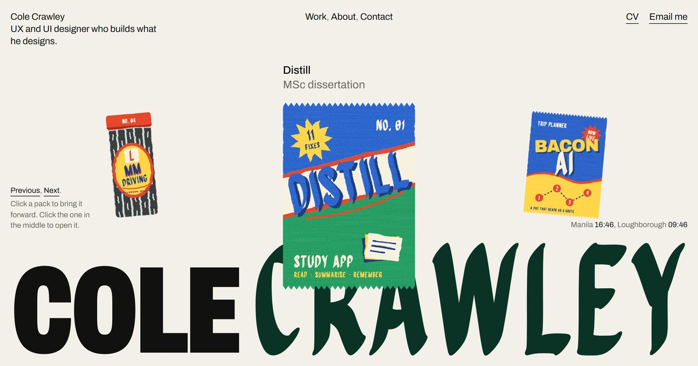

# Cole Crawley, portfolio

**[colecrawley.com](https://colecrawley.com)**

My UX and UI design portfolio. I grew up in Manila in the 2000s, and my pocket money went on snacks from the sari-sari store on the corner, so each project is drawn as its own snack packet on a shelf. Pick one up and it opens the case study.



---

## What's in it

- **Four case studies.** MMDriving (client work, live), Distill (MSc dissertation), BaconAI and CodeMarker. Each one leads with the outcome, my role and three results, then the decisions behind them.
- **Screens on coloured plates.** Screenshots are shown at full resolution and open larger on a click. Recordings of real flows only show actions, never a scroll through a site.
- **An About page** with what I do, how I work, where I come from, and references.
- **A CV that matches**, at `cv/Cole_Crawley_CV.pdf`.

---

## How it's built

Plain HTML, CSS and a little JavaScript, served as static files. No framework.

- Two typefaces (Archivo and Quiapo), a cream page and one racing green.
- Every picture comes in several widths in AVIF with WebP behind it, so a phone downloads a file that fits its screen and a large display gets the full detail. A blurred copy holds each picture's place while it loads, and a picture that fails is asked for again before a message with "Try again" appears.
- Pictures and headings wipe into view as you scroll. Anything skipped by a fast scroll plays when you come back to it, and nothing can stay hidden.
- Page-to-page transitions use cross-document view transitions. Everything respects reduced motion and works with JavaScript turned off.
- Checked at ten screen sizes from 320px to 2560px for overflow, missing or blurry pictures, readable text and tap targets.

---

## Running it locally

It's static, so any local server works:

```bash
python -m http.server 8000
```

Then open [http://localhost:8000](http://localhost:8000).

*Designed and built by Cole Crawley.*
